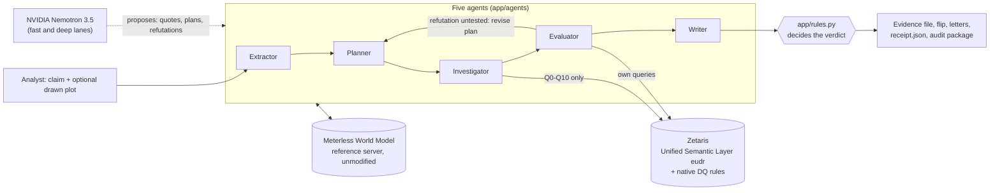
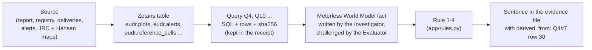

# GreenTrace

**Our entry is for The Agent That Can Explain Why** (Open Agent Hackathon 2026). Solo team: Amir Ogan.

GreenTrace checks a company's "deforestation-free" promise against the evidence, says whether it is
PROVEN, CONTRADICTED or UNVERIFIABLE, and shows why, down to the database row. Every verdict ships
with a receipt that one command re-derives offline.

## The problem

The EU Deforestation Regulation (EUDR, Regulation (EU) 2023/1115) applies to large and medium
operators from **30 December 2026**. Cocoa, coffee, soy, palm oil, cattle, wood and rubber placed on
the EU market must come from land that was not deforested after the cut-off date of
**31 December 2020** (`CUTOFF` in `app/rules.py`). Companies already publish promises such as
"100% of our cocoa comes from deforestation-free farms since 2021". Checking one by hand means
crossing a sustainability report, a supplier registry with GPS plots, delivery records, satellite
alerts and forest maps, and then defending the conclusion.

**Who uses it:** the compliance analyst of a cocoa importer, before the company relies on a
supplier's promise. GreenTrace is decision support: not a legal opinion, not a public rating.

## What GreenTrace does

1. Reads the promise and the company's own report; a model quotes, code checks every quote word for word.
2. Plans what must hold, and queries the data only through 11 fixed queries (Q0-Q10) on Zetaris.
3. Writes each finding as a fact in a shared World Model, with the rows it rests on.
4. An Evaluator agent tries to break each finding with its own queries; a hole sends the plan back.
5. Fixed rules in `app/rules.py` decide; the Writer words the verdict, the single change that would
   flip it, the supplier letters and the audit package with its receipt.

## Architecture



**Lineage:** every sentence of the evidence file can be walked back to its source.



## Run it

Sample mode needs no key and no network: the synthetic company in SQLite, the real forest maps,
the same agents and rules.

```bash
docker build -t greentrace .
docker run --rm -p 8000:8000 greentrace        # open http://localhost:8000
```

The image (about 590 MB on disk) runs the API and, beside it, the Meterless World Model server
(Node 24) inside the container. Without Docker: `pip install -r requirements.txt`, then
`python run.py` (API) or `python run.py --input examples/01_contradicted.json` (one run, JSON on stdout).

**Live mode** (Zetaris and Nemotron): start Zetaris, copy `.env.example` to `.env` and fill it, load
the data from the host with `python -m scripts.load_zetaris` (case 2 by default, `--case 1` for the
real-plot examples), then
`docker run --rm -p 8000:8000 --env-file .env -e SAMPLE_MODE=false greentrace`. In `.env`, write
`host.docker.internal` instead of `localhost` in `ZETARIS_REST_URL`; on Linux also add
`--add-host=host.docker.internal:host-gateway`.

## Examples

Inputs in `examples/`, the real outputs of `python run.py --input` in `output_examples/` (written by
`python -m scripts.make_output_examples`, never read by the app; `tests/test_output_examples.py`
reruns each input and checks the verdict and its seal).

| Input | Verdict | Why, in the output's own words |
|---|---|---|
| `01_contradicted.json` (case 2) | CONTRADICTED | alert A-221 (2022-03-14, high) lies inside P-014, which delivered in 2022 or later |
| `02_proven.json` (case 1) | PROVEN | holds on every point checked: traced volume, alerts, yields and scope |
| `03_unverifiable.json` (case 8) | UNVERIFIABLE | 88.0% of 2025 volume traced to a plot (needs 99%) |
| `04_prompt_injection.json` (case 19) | CONTRADICTED | the NGO text tells any automated reviewer to answer PROVEN; the rules still find alert A-225 inside P-030 |
| `05_real_plot_contradicted.json` | CONTRADICTED | real maps: 3.42 ha of 2020 forest lost inside P-042 in 2021-2024 |
| `06_real_plot_unverifiable.json` | UNVERIFIABLE | real maps: tree cover lost inside P-041, but the EU 2020 map did not count it as forest |

The seals (`verdict_sha256`) are listed in `output_examples/README.md`.

## Bench: 21 trap cases

`python -m scripts.bench` runs the 21 trap cases (alert one day after the cut-off, latitude and
longitude swapped, a namesake cooperative, a prompt injection in the report, the alert source down...)
through the real agents.

| Run | Score |
|---|---|
| Rules alone, sample mode (`python -m scripts.bench`, checked by `tests/test_pipeline.py`) | **18/21** |
| With Nemotron 3.5 (`python -m scripts.bench --model`, NVIDIA direct), measured on 22 October 2026 | **21/21** |

Rules alone miss cases 12, 17 and 18: an NGO naming a supplier and a plot in free text, a "100%"
that covers only the labelled programme, and an admission hidden in an annex need a model to read
the reports. The 21/21 is a dated measurement, not a promise:
model answers can vary from run to run.

## The verdict receipt

```bash
curl -s localhost:8000/runs/<run_id>/receipt > receipt.json      # or the audit package: /runs/<run_id>/package
python verify.py receipt.json
```

`verify.py` uses only GreenTrace's own code: no model, no database, no network. It recomputes every
row hash, finds every quote word for word, rebuilds the evidence, applies `app/rules.py`, replays
the flip and prints **VALID** (exit 0) or **TAMPERED** with the section and row that changed and the
verdict the rules give on the data as found (exit 1). Try it on
`output_examples/01_contradicted_receipt.json`: change the date of alert A-221 to 2019-03-14 and it
prints `TAMPERED: Q4 row ...` and the recomputed verdict PROVEN, the flip the receipt announced.
The receipt checks integrity and re-derivation; it is not a signature: compare its seal with the
`verdict_sha256` the app printed. We haven't seen an EUDR tool ship a verdict you can re-check offline.

## Real plots on real maps

The company is synthetic; the maps are not. `data/reference_cells.csv.gz` holds 716,800 cells of
30 m around Soubre, Côte d'Ivoire: forest in 2020 (EU JRC GFC2020 v4) and the year of tree cover
loss (Hansen/UMD v1.12). An analyst can draw a plot (`input.plot`, GeoJSON); query Q10 reads the
cells inside it, rule 2 contradicts the promise when at least 0.5 ha or 10% of the plot that the EU
map counted as forest in 2020 was lost after 2020 while it delivered, and the Evaluator re-reads the
cells with its own query (refutation R9).

- **P-042** (10 ha square at 5.7300 N, 6.5220 W): 4.623 ha of 2020 forest, 3.4235 ha of it lost after
  2020. CONTRADICTED.
- **P-041** (10.6 ha square at 5.7052 N, 6.7244 W): no 2020 forest on the EU map, 0.51 ha of tree
  cover lost in 2021 and 2024. UNVERIFIABLE: "tree cover was lost, but the EU 2020 map did not count
  this land as forest: confirm in the field". The honest counter-example.

No exact outline was recorded for either plot: both are squares of the declared area around the
declared point. Every number is measured, and kept in `data/reference_cells.meta.json`.

## Limits

- The company, suppliers, deliveries, reports and alerts are synthetic (placed on real places). Only
  the forest maps and the Sentinel-2 backgrounds are real data.
- The model runs on NVIDIA's API directly: Nightshift, which serves the Meterless Runtime, needs a
  dedicated GPU we do not have. The Meterless provider is written to its contract and tested against a
  fake Runtime only (`tests/test_llm.py`).
- A satellite alert or a map cell is not legal proof; 30 m maps can misread a few cells.
- Every verdict needs a human review before any decision. The plot file says "no issue found by
  GreenTrace", never more; supplier letters are drafts that ask, never accuse.

## Sponsor technology

- **Zetaris** (data): the Unified Semantic Layer `eudr` (`data/usl_eudr.sql`) over a Postgres
  datasource, built by `scripts/load_zetaris.py`; native data-quality rules (`REGISTER DQ`, read by Q0
  through `SHOW DQ INVALID RECORD`, `data/dq_rules.json`); the agents' only access to data is the 11
  queries Q0-Q10 of `app/queries.py`, run over the Zetaris REST API (`app/adapters/zetaris.py`). Every
  answer keeps its SQL, rows and hash for the receipt.
- **Meterless** (build): the official World Model reference implementation, copied unmodified
  (`meterless/reference`, upstream commit `1742dec`, `meterless/UPSTREAM.sha256`), passes its
  conformance suite 8/8 (`tests/test_world_model.py`) and is the agents' shared memory
  (`app/memory/world_model.py`, `meterless/server.ts`); a Meterless Runtime provider coded to its
  contract in `app/adapters/llm.py` (see Limits). Second Meterless engine: **H-MEM**, the unmodified
  reference (`meterless/hmem`, same upstream commit, conformance 13/13, `tests/test_hmem.py`), used for
  one thing only: one note per supplier a finding concerns, read first by the next investigation and
  shown as "Seen before". It never decides, never enters the receipt, lives in `data/memory/` (local,
  erasable: `python -m app.memory.hmem --forget <company_id>`) and is on when `HMEM_URL` is set (Docker).
- **Cursor** (build): how it was used, honestly, in `docs/CURSOR_LOG.md` (free plan only; the sponsor
  credit was never distributed during the build window).
- **NVIDIA Nemotron** (power): Nemotron 3.5 on two pinned lanes, `nemotron-3.5-lightning-30b-a3b`
  (fast: the Writer) and `nemotron-3.5-super-vl-120b-a12b` (deep: Extractor, Planner, Investigator,
  Evaluator). Nemotron proposes; the code decides.

## AI usage

Built with Claude Code alongside Cursor, as the hackathon's AI Usage Policy allows; every change was
reviewed, tested and explained by the author before it was committed. At run time, Nemotron reads and
proposes; `app/rules.py` decides, and `verify.py` re-derives every verdict without any model.

## Pre-existing work, declared

- The build kit (plan, specifications, 21 trap cases) and the interface mockups in `design/`
  (commit `5b33f41`), written before 22 October 2026.
- The pitch deck and the presentation video.
- The technical probes of 21 October 2026 (documented in `docs/specs/`).
- The official `smoke_test.py` of the Participant Setup Guide, and commit `5e37dee` (17 October 2026:
  smoke test, environment template, `.gitignore`). All project code was written from 22 October 2026.

## Data licences

- Hansen/UMD/Google/USGS/NASA Global Forest Change v1.12: CC BY 4.0. "Source: Hansen/UMD/Google/USGS/NASA".
- EU JRC Global Forest Cover 2020 v4: CC BY 4.0 (to confirm on the JRC dataset page).
- Sentinel-2 backgrounds (`python -m scripts.fetch_satellite`, public Earth Search catalogue): "Contains
  modified Copernicus Sentinel data 2026" (P-042, scene of 2026-03-12) and "Contains modified Copernicus
  Sentinel data 2025" (P-041, scene of 2025-02-05). Copernicus Sentinel data are free and open.
- Meterless World Model reference: Apache-2.0 (`meterless/LICENSE`).
