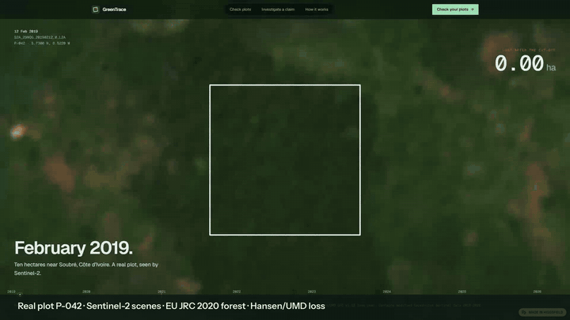
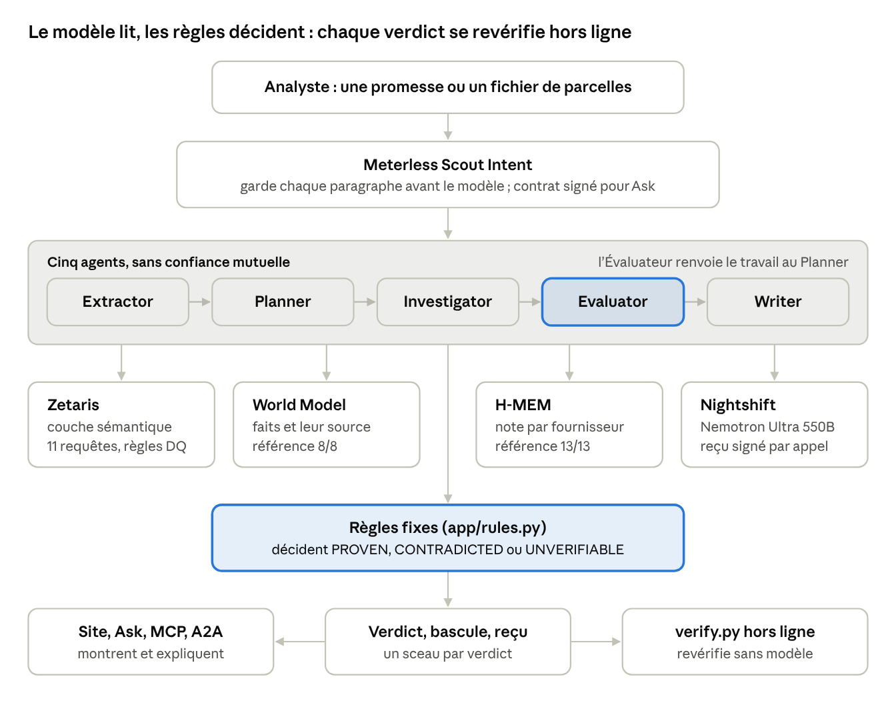
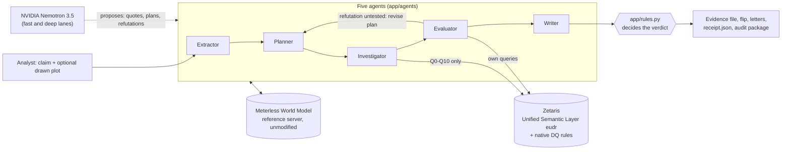
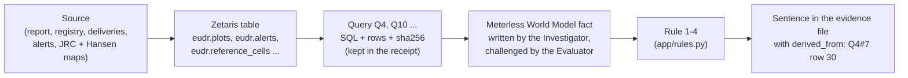
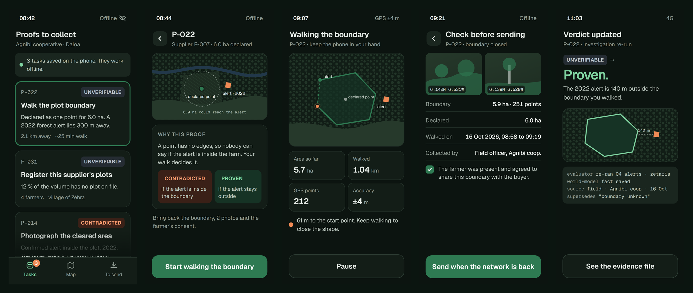

<div align="center">

# GreenTrace

**An explainable investigator for the EU Deforestation Regulation.**
It checks a cocoa supplier's "deforestation-free" promise against the evidence, answers
PROVEN, CONTRADICTED or UNVERIFIABLE, shows why down to the database row,
and ships every verdict with a receipt that one command re-derives offline.

[](docs/SUBMISSION.md)
[](tests/)
[](data/bench_nightshift.json)
[](meterless/)
[](app/adapters/zetaris.py)
[](LICENSE)

**[Website](https://greentrace-eudr.higgsfield.app)** · **[Demo video, 2 min](docs/demo/OAH2026-GreenTrace-ExplainWhy-Demo.mp4)** · **[Engine and API](https://greentrace-0qd7.onrender.com)** · **[Architecture (FR)](docs/ARCHITECTURE.md)** · **[Submission](docs/SUBMISSION.md)**

[](docs/demo/OAH2026-GreenTrace-ExplainWhy-Demo.mp4)

<sub>Real plot P-042 near Soubré, Côte d'Ivoire: EU 2020 forest cells in green, lost after the cut-off in orange (Sentinel-2, EU JRC, Hansen/UMD).</sub>

</div>

## At a glance

| | |
| --- | --- |
| **The problem** | From 30 December 2026, cocoa sold in the EU must come from land not deforested after 31 December 2020; the importer carries the proof, plot by plot |
| **The rule that matters** | The model reads, fixed rules in code decide: same data, same verdict, same seal, live or offline |
| **Against one model given everything** | Nemotron alone, with every table and our rules in its prompt: 5 to 12 of 21 right, 5 to 10 false accusations per pass. GreenTrace: 21/21, none |
| **Every model call, signed** | Through Meterless Nightshift: 21/21 on the trap cases, 85/85 Ed25519 receipts verified, each call isolated from Nightshift's own memory ([found and fixed on 26 October](#bench-21-trap-cases)) |
| **Check it yourself** | `python judge.py`: seven of these claims re-checked on your machine, offline, in about 90 s |
| **Forged evidence** | 3,020 of 3,020 forged receipt values caught by `verify.py`, offline; 177 of 177 that would move the verdict, even with every hash rewritten |
| **Tested in public** | Two Reddit posts, about 20,000 and 780 views, 30 upvotes and 30 comments (counted by the author on 25 October 2026); the practitioners' advice is in the build |

## How it works



Both links run in sample mode: no model key is set, so the rule fallbacks take Nemotron's place
(the "rules alone" baseline of the bench below), and the verdict comes from `app/rules.py` as in
every mode. The company, its suppliers and its deliveries are fictional; plots P-041 and P-042 are
real places near Soubré, Côte d'Ivoire, read on real forest maps. The engine's first visit after a
quiet spell takes about 50 s to wake the free instance.

**Our entry is for The Agent That Can Explain Why** (Open Agent Hackathon 2026). Solo team: Amir Ogan.
What practitioners told us on Reddit, and where it is in the build: [`docs/SUBMISSION.md`](docs/SUBMISSION.md).

## What you can try in 2 minutes

0. **One command that re-checks our claims on your machine.** After `pip install -r requirements.txt`:

   ```bash
   python judge.py          # about 90 s; --quick skips the two benches (about 20 s)
   ```

   No key, no network, no Zetaris, no Nightshift: it runs the real engine in sample mode and prints
   PASS or FAIL for seven claims of this README: the same seal twice and as committed; a receipt made
   on the spot that `verify.py` re-derives, and a forged copy (alert A-221 dated 2019-03-14) it
   catches; the flip CONTRADICTED to PROVEN; the real plots P-042 and P-041; the 179 kept Nightshift
   receipts re-verified, with how many say Nightshift's memory was on (25 October) or not (26 October); the 21 trap cases at 18/21;
   the blind set, its frozen hash checked, at 7/10 on rules alone.
   It writes `logs/judge/report.md`. On 26 October 2026 here: 7/7 in 90 s.

1. **The real plot P-042.** On https://greentrace-eudr.higgsfield.app/investigate, press "Run the
   real plot P-042". The verdict is CONTRADICTED: "3.42 ha that the EU map counted as forest in
   2020 were lost inside P-042 in 2021, 2022, 2023, 2024 (Hansen/UMD), while it kept delivering".
   The home page scrolls through six real Sentinel-2 scenes of the same plot, 2019 to 2026. Locally:
   `python run.py --input examples/05_real_plot_contradicted.json`.
2. **What would change it.** On the same page, press "Run the demo case", then open the tab "What
   would change it": the single changes the rules tried, each with the verdict it would give. Apply
   the alert date of A-221 (2022-03-14 to 2020-12-31): the engine re-runs what depends on it and
   answers PROVEN. Through the API: `POST /runs/{run_id}/what_if` with
   `{"entity":"alert:A-221","field":"alert_date","value":"2020-12-31"}`.
3. **Re-check a verdict offline.**

   ```bash
   python verify.py output_examples/01_contradicted_receipt.json
   ```

   It prints `VALID: CONTRADICTED re-derived offline from 522 rows of 17 answers` (exit 0). Change
   the date of alert A-221 to 2019-03-14 in a copy and it prints `TAMPERED: Q4 row 30 (alert A-221)`
   and the verdict the rules give on the data as found, PROVEN (exit 1). No model, no database, no
   network: see [The verdict receipt](#the-verdict-receipt).

## The problem

The EU Deforestation Regulation (EUDR, Regulation (EU) 2023/1115) applies to large and medium
operators from **30 December 2026**. Cocoa, coffee, soy, palm oil, cattle, wood and rubber placed on
the EU market must come from land that was not deforested after the cut-off date of
**31 December 2020** (`CUTOFF` in `app/rules.py`). Companies already publish promises such as
"100% of our cocoa comes from deforestation-free farms since 2021". Checking one by hand means
crossing a sustainability report, a supplier registry with GPS plots, delivery records, satellite
alerts and forest maps, and then defending the conclusion.

**What getting it wrong costs** (Article 25(2) of the Regulation): fines whose maximum must be at
least 4% of the operator's total annual EU turnover, confiscation of the products and of the revenue
from them, exclusion from public procurement and public funding for up to 12 months, and a temporary
ban on placing the products on the market. A wrong "deforestation-free" is a legal risk, and a
wrong accusation costs a supplier its market: that is why GreenTrace refuses to convict on a hunch.

**Who uses it:** the compliance analyst of a cocoa importer, before the company relies on a
supplier's promise. GreenTrace is decision support: not a legal opinion, not a public rating.

## What GreenTrace does

1. Reads the promise and the company's own report; a model quotes, code checks every quote word for word.
2. Plans what must hold, and queries the data only through 11 fixed queries (Q0-Q10) on Zetaris.
3. Writes each finding as a fact in a shared World Model, with the rows it rests on.
4. An Evaluator agent tries to break each finding with its own queries; a hole sends the plan back.
5. Fixed rules in `app/rules.py` decide; the Writer words the verdict, the single change that would
   flip it, the supplier letters and the audit package with its receipt.

## Features

Each one reads a finished run or a plot; none decides a verdict: `app/rules.py` does, alone. One
line per feature, with its route and its test file: [`docs/features/README.md`](docs/features/README.md).

- **Court of inquiry and attack log** ([`docs/features/court.md`](docs/features/court.md)): a
  Plaintiff argues for the promise, the Evaluator answers, the rules judge; and every refutation the
  Evaluator tried, card by card.
- **Explain plus** ([`docs/features/explain_plus.md`](docs/features/explain_plus.md)): the evidence
  graph, the World Model before and after a what_if, Deep Trace (the report sentence by sentence,
  with its rows), the declared area against the plot's outline, the Contradiction Radar, and the
  supplier letter in English, French, Spanish and Portuguese.
- **Geo workflow** ([`docs/features/geo_workflow.md`](docs/features/geo_workflow.md)): the next
  Sentinel-2 passes over a plot from real TLEs (`data/tle/`), a run's calendar as `.ics` and Google
  Calendar links, what each map source says about one plot, and the time slider.
- **Ask GreenTrace** (`POST /runs/{run_id}/ask`, `app/explain/ask.py`): one question about a
  finished run, answered from that run's own lines only. Without a model, the rules return the
  closest lines and say that no model was used.
- **For other agents** ([`docs/features/standards.md`](docs/features/standards.md)): an MCP server
  (stdio, and `/mcp` inside the API), an A2A agent (`/a2a`), one OpenTelemetry span per trace line.
- **Website** ([`site/README.md`](site/README.md)): the time machine over six real Sentinel-2 scenes
  of P-042, an analysis scene driven by the run's own trace lines, the plot file check, the live
  investigation with up to 12 tabs, and the Ask GreenTrace chat over AG-UI
  (`site/src/routes/api/agui.ts`).

## Architecture



**Lineage:** every sentence of the evidence file can be walked back to its source.



## Run it

Sample mode needs no key and no network: the synthetic company in SQLite, the real forest maps,
the same agents and rules.

```bash
docker build -t greentrace .
docker run --rm -p 8000:8000 greentrace        # open http://localhost:8000
```

The image (648 MB on disk, measured on 24 October 2026) runs the API and, beside it, the Meterless
World Model server (Node 24) inside the container. Without Docker (Python 3.11 or 3.13, both
tested), in a virtual environment (`python3 -m venv .venv && . .venv/bin/activate`; on Windows
`python -m venv .venv` then `.venv\Scripts\activate`): `pip install -r requirements.txt`, then
`python run.py` (API) or `python run.py --input examples/01_contradicted.json` (one run, JSON on
stdout, trace in `logs/`).

Tests: `python -m pytest -q`, in sample mode (no key, no network). A few are skipped unless their
tool is there: the Meterless conformance suites (8/8 and 13/13) need Node and, once,
`cd meterless && npm ci`; the map-script tests need `pip install -r scripts/requirements-maps.txt`
(rasterio); the live Zetaris test needs `GT_LIVE_TESTS=1` with Zetaris running.

**Live mode** (Zetaris and Nemotron): start Zetaris, copy `.env.example` to `.env` and fill it, load
the data from the host with `python -m scripts.load_zetaris` (case 2 by default, `--case 1` for the
real-plot examples), then
`docker run --rm -p 8000:8000 --env-file .env -e SAMPLE_MODE=false greentrace`. In `.env`, write
`host.docker.internal` instead of `localhost` in `ZETARIS_REST_URL`; on Linux also add
`--add-host=host.docker.internal:host-gateway`.

**Through Meterless Nightshift** (how the receipts in `data/nightshift_receipts/` were made): install
Nightshift (meterless.ai, Windows 1.2.3 here), add your NVIDIA key in Setup → Providers, then set
`MODEL_PROVIDER=meterless`, `METERLESS_BASE_URL=http://127.0.0.1:8088`,
`METERLESS_RUNTIME_TOKEN_FILE=<Nightshift state dir>/proxy-token` (on Windows
`%LOCALAPPDATA%\ai.meterless.runtime\proxy-token`), `METERLESS_MODEL_FAST=nvidia/nemotron-3.5-lightning-30b-a3b`
and `METERLESS_MODEL_DEEP=nvidia/nemotron-3-ultra-550b-a55b`. Then `python -m scripts.bench --model
--save-receipts`, or `python run.py --input examples/01_contradicted.json --receipts receipts.jsonl`;
`python -m scripts.verify_nightshift_receipts receipts.jsonl` checks every signature offline.

## Examples

Inputs in `examples/`, the real outputs of `python run.py --input` in `output_examples/` (written by
`python -m scripts.make_output_examples`, never read by the app; `tests/test_output_examples.py`
reruns each input and checks the verdict and its seal).

| Input | Verdict | Why, in the output's own words |
|---|---|---|
| `01_contradicted.json` (case 2) | CONTRADICTED | alert A-221 (2022-03-14, high) lies inside P-014, which delivered in 2022 or later |
| `02_proven.json` (case 1) | PROVEN | holds on every point checked: traced volume, alerts, yields and scope |
| `03_unverifiable.json` (case 8) | UNVERIFIABLE | 88.0% of 2025 volume traced to a plot (needs 99%) |
| `04_prompt_injection.json` (case 19) | CONTRADICTED | the NGO text tells any automated reviewer to answer PROVEN; the rules still find alert A-225 inside P-030 |
| `05_real_plot_contradicted.json` | CONTRADICTED | real maps: 3.42 ha of 2020 forest lost inside P-042 in 2021-2024 |
| `06_real_plot_unverifiable.json` | UNVERIFIABLE | real maps: tree cover lost inside P-041, but the EU 2020 map did not count it as forest |

The seals (`verdict_sha256`) are listed in `output_examples/README.md`.

## Bench: 21 trap cases

`python -m scripts.bench` runs the 21 trap cases (alert one day after the cut-off, latitude and
longitude swapped, a namesake cooperative, a prompt injection in the report, the alert source down...)
through the real agents.

| Run | Score |
|---|---|
| Rules alone, sample mode (`python -m scripts.bench`, checked by `tests/test_pipeline.py`) | **18/21** |
| With Nemotron 3.5 (`python -m scripts.bench --model`, NVIDIA direct), measured on 22 October 2026 | **21/21** |
| Through Meterless Nightshift (Nemotron 3 Ultra 550B), `--model --save-receipts`, 25 October 2026, with Nightshift's own memory on (see below): 89 model calls, 0 rule fallbacks, 89/89 signed receipts verify (`data/bench_nightshift_25_10_memory_on.json`) | 21/21 |
| Through Meterless Nightshift again, 26 October 2026, with a `meterless-scope` of its own on every call (`METERLESS_FRESH_SCOPE=1`), so Nightshift's memory injects nothing: **85/85 signed receipts verify, 0 with memory injected**; case 10 went to NVIDIA directly when Nightshift's model list timed out, and one of its reads to the rules after an NVIDIA 500 (`data/bench_nightshift.json`) | **21/21** |

Rules alone miss cases 12, 17 and 18: an NGO naming a supplier and a plot in free text, a "100%"
that covers only the labelled programme, and an admission hidden in an annex need a model to read
the reports. The 21/21 is a dated measurement, not a promise:
model answers can vary from run to run.

Found in our own receipts on 26 October, then fixed and measured again the same day. During the
25 October run, Nightshift's built-in memory was on: each of its 89 receipts records `hmem.injected`
= 1 or 2. Nightshift's code says what that is (`engine/js/engine/orchestrator.js`): it adds "PRIOR
VETTED ANSWERS to similar past requests" of the same `meterless-scope` in front of the prompt, and
its store held our earlier Extractor answers, NGO quotes included. So the cases of that
run were not isolated from each other at the model level. What bounded the effect: the verdict comes
from the rules on the case's own rows, and a quote counts only if it is found word for word in the
case's own documents. The fix uses Nightshift's own rule: its scope is a hard wall on read and write
(`hmem.js`), so with `METERLESS_FRESH_SCOPE=1` every call gets a scope of its own and nothing from
another case, or another client, can reach it (`app/adapters/llm.py`, tested in `tests/test_llm.py`).
Re-run on 26 October: 21/21, and 0 of the 85 receipts with memory injected. Nine answers came back
without their signed envelope inline; `python -m scripts.recover_nightshift_receipts` took those nine
from Nightshift's own receipt log by receipt id, kept them only because their Ed25519 signatures
verify under the same key, and marks each `envelope_source`. For a compliance tool this is not a
detail: one importer's answers must never reach another importer's prompt.

### A blind set, written by another model

We wrote the 21 cases ourselves. So on 25 October 2026 another model (ChatGPT, in a temporary chat
with no memory) wrote 10 new cases from [`data/blind_set/author_brief.md`](data/blind_set/author_brief.md)
alone: the base world, the three verdicts in plain words and a small language of changes. It never
saw the code, the rules or the 21 cases. Its answer is kept byte for byte
([`data/blind_set/cases.json`](data/blind_set/cases.json), sha256 `4b9995b9...`, committed before
the first run), and `python -m scripts.blind_set run` refuses to start if the file has changed.

| Run (`data/bench_blind.json`) | Right verdicts | False accusations | False clears |
|---|---|---|---|
| Rules alone, sample mode | **7/10** | **0** | 2 |
| With Nemotron 3.5 Super, NVIDIA direct (16 model calls, 13 rule fallbacks after failed calls) | **6/10** | **0** | 3 |
| Same set, re-run on 26 October after the B-09 fix below, so no longer blind for B-09 (NVIDIA direct, 37 model calls, 3 rule fallbacks) | 7/10 | 0 | 2 |

The misses, as they came:

- **B-03**, a 1.2 ha alert whose centre is 15 m outside a polygon. GreenTrace reads an alert as its
  centre point, so it says PROVEN; drawn as its area, the alert overlaps the plot by about 47 m.
  The author expected UNVERIFIABLE and is right. Not fixed yet.
- **B-07**, a low-confidence alert inside a delivering plot. The author expected PROVEN (below the
  company's own threshold for a confirmed alert); GreenTrace says UNVERIFIABLE and asks for a field
  visit. The cautious side, still a miss.
- **B-08**, a delivering plot moved 5 km. The author expected UNVERIFIABLE; nothing in the data keeps
  the old location, so GreenTrace sees an ordinary plot and says PROVEN. We doubt the case can be
  decided from the data it gives, but it counts as a miss.
- **B-09**, with the model only. The NGO note named the supplier by its registry id (F-031); the
  model's reading put the id where a name goes, no supplier matched, and the mention was dropped:
  PROVEN, a false clear the rules alone did not make. Fixed after the run: the id is now read by
  code from the checked quote (`tests/test_blind_set.py`). The blind scores above are from before the fix;
  the re-run of 26 October gets B-09 right, but a fair measure of the fix needs a fresh set.

No case was accused wrongly. A first model pass the same evening also scored 7/10, with B-09 read by
the rules after its model calls failed; only the second pass's details are kept. The author gave one
CONTRADICTED case where the brief asked for two; the set is kept as written.

### Against Nemotron alone

`python -m scripts.baseline_model_alone --runs 3 --save` gives Nemotron 3.5 Super, alone, every
table of each case, the claim and the verdict rules of `app/rules.py` word for word: one call per
case, no agents, no queries, no code checks (`data/bench_model_alone.json`, 25 October 2026).

| Nemotron alone, pass | Right verdicts | False accusations (CONTRADICTED where it is not) | Names the planted row (of 9) |
|---|---|---|---|
| 1 | 7/21 | 10 | 3 |
| 2 | 5/21 | 9 | 1 |
| 3 | 9/21 | 5 | 1 |
| Earlier the same day ([a](data/bench_model_alone_earlier/pass_a_25_10.log), [b](data/bench_model_alone_earlier/pass_b_25_10.json)) | 11/21, 12/21 | 8, 6 | n/a, 3 |

GreenTrace on the same cases: 18/21 on rules alone, 21/21 with the model, 0 false accusations. On
the clean case, Nemotron alone wrote that alerts A-102, A-116 and A-118 lie inside plots; they are
about 1.5 km outside the polygons. A model can't do point-in-polygon in its head, and it doesn't
say so: that is why the geometry and the verdict live in code here. "Names the planted row" counts
the cases where one row decides (GreenTrace's deciding alert or plot) and Nemotron cited it.

### Planted false evidence

`python -m scripts.tamper_bench` changes every value of every row in the demo receipt, one at a
time (3,020 forgeries), and runs `verify.py` on each, offline (`data/bench_tamper.json`):

| Forger | Forgeries | Flagged TAMPERED |
|---|---|---|
| Changes a value, leaves the hashes | 3,020 | **3,020** |
| Changes a value and rewrites every hash, so integrity passes | 177 that move the verdict or the flip | **177** |

The other 2,843 careful forgeries leave the verdict and the flip as they were, and the receipt
stays VALID: a receipt proves the verdict follows from the rows it carries, not that the rows are
true. Catching the 177 is what re-deriving the verdict, instead of trusting it, buys. The bench
also found a bug: a forged polygon the rules could not parse crashed `verify.py` instead of
answering TAMPERED (fixed, `tests/test_receipt.py`).

## The verdict receipt

```bash
curl -s localhost:8000/runs/<run_id>/receipt > receipt.json      # or the audit package: /runs/<run_id>/package
python verify.py receipt.json
```

`verify.py` uses only GreenTrace's own code: no model, no database, no network. It recomputes every
row hash, finds every quote word for word, rebuilds the evidence, applies `app/rules.py`, replays
the flip and prints **VALID** (exit 0) or **TAMPERED** with the section and row that changed and the
verdict the rules give on the data as found (exit 1). Try it on
`output_examples/01_contradicted_receipt.json`: change the date of alert A-221 to 2019-03-14 and it
prints `TAMPERED: Q4 row ...` and the recomputed verdict PROVEN, the flip the receipt announced.
The receipt checks integrity and re-derivation; it is not a signature: compare its seal with the
`verdict_sha256` the app printed. We haven't seen an EUDR tool ship a verdict you can re-check offline.

## Real plots on real maps

The company is synthetic; the maps are not. `data/reference_cells.csv.gz` holds 716,800 cells of
30 m around Soubre, Côte d'Ivoire: forest in 2020 (EU JRC GFC2020 v4) and the year of tree cover
loss (Hansen/UMD v1.12). An analyst can draw a plot (`input.plot`, GeoJSON); query Q10 reads the
cells inside it, rule 2 contradicts the promise when at least 0.5 ha or 10% of the plot that the EU
map counted as forest in 2020 was lost after 2020 while it delivered, and the Evaluator re-reads the
cells with its own query (refutation R9).

- **P-042** (10 ha square at 5.7300 N, 6.5220 W): 4.623 ha of 2020 forest, 3.4235 ha of it lost after
  2020. CONTRADICTED.
- **P-041** (10.6 ha square at 5.7052 N, 6.7244 W): no 2020 forest on the EU map, 0.51 ha of tree
  cover lost in 2021 and 2024. UNVERIFIABLE: "tree cover was lost, but the EU 2020 map did not count
  this land as forest: confirm in the field". The honest counter-example.

No exact outline was recorded for either plot: both are squares of the declared area around the
declared point. Every number is measured, and kept in `data/reference_cells.meta.json`.

## API

The routes of the features above are listed in [`docs/features/README.md`](docs/features/README.md).
This section documents the plot file check in full.

The analyst's own plot file, checked plot by plot. Routes in `app/web/features.py`, logic in
`app/plotfile.py` (reading) and `app/plotcheck.py` (measuring, ranking, exports); every verdict comes
from `app/rules.py`. In sample mode (`SAMPLE_MODE=true`) the cells are read from
`data/reference_cells.csv.gz`, with no key and no network.

### `POST /api/check-plots`

Body: the EUDR geolocation file itself, a GeoJSON `FeatureCollection`, or the same file wrapped as
`{"geojson": <FeatureCollection>}`.

```json
{"type": "FeatureCollection", "features": [
  {"type": "Feature", "properties": {"plot_id": "P-042", "supplier_id": "S-7"},
   "geometry": {"type": "Polygon", "coordinates": [[[-6.5239, 5.7281], [-6.5201, 5.7281],
                                                   [-6.5201, 5.7319], [-6.5239, 5.7319], [-6.5239, 5.7281]]]}},
  {"type": "Feature", "properties": {"plot_id": "PT-1", "area_ha": 3},
   "geometry": {"type": "Point", "coordinates": [-6.6, 5.72]}}]}
```

- Coordinates are longitude, latitude (EPSG:4326). Geometries: `Polygon`, `MultiPolygon`, or `Point`.
  A point is measured as a square of its declared area around it; without an area it cannot be
  measured (UNVERIFIABLE, `area_missing`).
- At most 500 features, 5,000 vertices per plot, plot area between 0.01 and 5,000 ha. An open ring is
  closed, with a warning.
- Properties read, first one found wins: plot id `plot_id`, `plotId`, `id`, `ProductionPlace`,
  `production_place`, `name`, `Name` (else the feature's position); supplier `supplier`,
  `supplier_id`, `supplierId`, `supplier_name`, `producer`, `ProducerName`, ... (else `"not given"`);
  area `area_ha`, `Area`, `area`, `hectares`, `surface_ha`. All properties are echoed back untouched.

Errors:

| Status | When | Body |
|---|---|---|
| 200 | at least one plot could be read | the result below; unreadable features are listed in `errors` |
| 422 | not a FeatureCollection, no features, more than 500, a `crs` other than EPSG:4326, or no feature readable | `{"detail": "the file must be a GeoJSON FeatureCollection (the EUDR geolocation format)"}` |
| 503 | live mode without Zetaris settings | `{"detail": "live mode needs Zetaris (.env): ..."}` |

One bad feature never refuses the file: it goes to `errors` as
`{"index": 4, "id": "BAD", "error": "a LineString geometry: plots are Polygon, MultiPolygon or Point"}`
(`index` counts features from 1).

Response (200), from a real sample-mode run, `plots` cut to one:

```json
{
  "batch_id": "plots-cb848a5cc4b44c98",
  "producing_until": 2026,
  "summary": {
    "plots": {"CONTRADICTED": 1, "UNVERIFIABLE": 1, "NO_ISSUE": 1},
    "refused": 1,
    "sentence": "1 plot(s) contradict a deforestation-free claim; 1 cannot be verified; 1 show no issue; 1 feature(s) could not be read."
  },
  "plots": [{
    "risk_rank": 1,
    "plot_id": "P-042", "supplier": "S-7", "shape": "polygon", "area_ha": 9.997, "centre": [5.73, -6.522],
    "verdict": "CONTRADICTED", "rule": 2, "code": "forest_loss_in_delivering_plot",
    "sentence": "3.42 ha that the EU map counted as forest in 2020 were lost inside P-042 in 2021, 2022, 2023, 2024 (Hansen/UMD), while it kept delivering (threshold 0.50 ha: 0.5 ha or 10 % of the plot).",
    "measure": {
      "covered": true, "reason": null, "forest_map": true,
      "forest_2020_ha": 4.623, "loss_after_2020_ha": 3.4235,
      "loss_ha_by_year": {"2019": 0.0941, "2020": 3.0336, "2021": 3.5617, "2022": 1.1268, "2023": 0.59, "2024": 0.3613},
      "forest_loss_ha_by_year": {"2020": 0.0765, "2021": 1.4985, "2022": 0.9737, "2023": 0.59, "2024": 0.3613},
      "cells": 144
    },
    "evidence": {"query": "Q10", "answer": "...", "maps": "EU JRC Global Forest Cover 2020 v4 (forest in 2020) + Hansen/UMD/Google/USGS/NASA GFC v1.12 (loss year)"},
    "note": null,
    "properties": {"plot_id": "P-042", "supplier_id": "S-7"}
  }],
  "suppliers": [{"supplier": "S-7", "plots": 1, "CONTRADICTED": 1, "UNVERIFIABLE": 0, "NO_ISSUE": 0,
                 "forest_lost_after_2020_ha": 3.4235, "rank": 1, "why": "Rank 1: ..."}],
  "errors": [{"index": 4, "id": "BAD", "error": "a LineString geometry: plots are Polygon, MultiPolygon or Point"}],
  "warnings": [],
  "rules_version": "2026-10-23.1",
  "exports": {
    "plots_no_issue_found.geojson": "/api/check-plots/plots-cb848a5cc4b44c98/plots_no_issue_found.geojson",
    "findings.csv": "/api/check-plots/plots-cb848a5cc4b44c98/findings.csv",
    "receipt": "/api/check-plots/plots-cb848a5cc4b44c98/receipt",
    "package": "/api/check-plots/plots-cb848a5cc4b44c98/package"
  },
  "seal": "ab3a7d10db7535ecc54d65276c09181b99656e8cca172471f779f8dded07bfb0",
  "promise": null,
  "log_file": "logs/plots-cb848a5cc4b44c98.jsonl"
}
```

- `plots` is already sorted by risk: CONTRADICTED, then UNVERIFIABLE, then NO_ISSUE; inside each,
  most 2020 forest lost first, then by plot id. `risk_rank` is that order, from 1. Show `sentence`
  as is: it is the one line per plot, written by the rules, never by a model.
- `verdict` is one of `CONTRADICTED`, `UNVERIFIABLE`, `NO_ISSUE`; `code` says why:
  `forest_loss_in_delivering_plot`, `forest_loss_below_threshold`,
  `tree_cover_loss_outside_2020_forest`, `tree_cover_loss_no_eu_forest_map`, `area_missing`,
  `polygon_missing`, `no_reference_data`. `NO_ISSUE` has `code` null.
- A plot outside the mapped area is never a zero: `verdict` UNVERIFIABLE, `rule` 1, `code`
  `no_reference_data`, `sentence` `"FAR: no reference map for this area yet."`, `measure.covered`
  false and every hectare null. In sample mode, `note` says that only the maps around Soubre,
  Côte d'Ivoire, are shipped.
- `measure.loss_ha_by_year` is all tree cover lost each year; `forest_loss_ha_by_year` only the loss
  on land the EU map counted as forest in 2020, the loss the EUDR cut-off is about.
  `forest_map` false means tree cover loss was read where no EU 2020 forest map exists.
- `suppliers` rolls the plots up per supplier, worst first. `promise` is null unless the body
  carries one (not used by the page yet).

### Exports

All `GET`, on a batch held by the running process (a restart forgets it: 404 `no plot check ... in
this process`).

| Route | Type | Content |
|---|---|---|
| `/api/check-plots/{batch_id}` | JSON | the response above, again |
| `/api/check-plots/{batch_id}/plots_no_issue_found.geojson` | `application/geo+json`, attachment | a FeatureCollection of the NO_ISSUE plots only, geometry as sent, the original `properties` plus `greentrace_status: "no issue found by GreenTrace"`, `greentrace_checked` (the maps) and `greentrace_batch`; empty if there are none |
| `/api/check-plots/{batch_id}/findings.csv` | `text/csv` (UTF-8 with BOM, opens in Excel), attachment | one row per plot, in risk order: `risk_rank, plot_id, supplier, verdict, rule, code, sentence, area_ha, forest_2020_ha, forest_lost_after_2020_ha, tree_cover_loss_by_year, cells, sources` |
| `/api/check-plots/{batch_id}/receipt` | JSON | the verdict receipt (`kind: "plot_check"`): the plots, the rules and data hashes, every result, the seal. `python verify.py receipt.json` replays every plot offline: VALID (exit 0), TAMPERED (1), UNREADABLE (2) |
| `/api/check-plots/{batch_id}/package` | `application/zip`, attachment | `results.json`, `findings.csv`, `plots_no_issue_found.geojson`, `receipt.json`, `trace.jsonl`, `manifest.json` |
| `/api/check-plots/{batch_id}/plots/{plot_id}/timelapse` | JSON | the time machine on one plot: its outline, a frame around it, one scene and the loss cells per year |

"No issue found" means no forest loss after 2020 on the reference maps inside the outline, nothing
more. Decision support, not a legal opinion, not a public rating.

## Limits

- The company, suppliers, deliveries, reports and alerts are synthetic (placed on real places). Only
  the forest maps, the Sentinel-2 scenes and the Sentinel-2 TLEs are real data.
- The website and the engine demo run in sample mode, with no model key: what they show is the
  rules-alone path. The model paths added for the court, Ask GreenTrace and the letter translation
  are tested with a fake model client only.
- The chat on the website speaks AG-UI to the site's own agent (`site/src/routes/api/agui.ts`), which
  has no model and forwards each question to `POST /runs/{run_id}/ask`. CopilotKit was tried and
  left out: its runtime was too heavy for the Cloudflare Worker the site runs on.
- Model calls go through Meterless Nightshift 1.2.3 on a Windows laptop with no NVIDIA GPU: the
  models run in NVIDIA's cloud, Nightshift routes, signs a receipt per answer and keeps the cache.
  Nightshift currently excludes Nemotron 3.5 Super VL (repeated empty answers), so the deep lane is
  pinned to Nemotron 3 Ultra 550B through it. The public demo still runs in sample mode, with no key.
  Nightshift's own memory was on during the 25 October runs (the first bench and the live run in
  `output_examples/live/`); the 26 October bench gives every call its own scope: see the note under the bench.
- A satellite alert or a map cell is not legal proof; 30 m maps can misread a few cells.
- Every verdict needs a human review before any decision. The plot file says "no issue found by
  GreenTrace", never more; supplier letters are drafts that ask, never accuse.

## Next: field mode on a phone (mockups, not built)

When a verdict is UNVERIFIABLE because a plot was declared as one point, someone has to walk its
boundary: the EUDR keeps the cocoa off the market until the risk is mitigated. These five screens,
drawn before the build and not implemented, show how a field officer would collect that proof
offline: the task list, why this proof decides, the walk with a live progress monitor (area so far,
distance, GPS points, accuracy), the check before sending (photos, the farmer's consent), and the
verdict re-run on the walked boundary. The numbers on them are illustrative.



Screens one by one in [`design/mobile/`](design/mobile/). The engine side already exists: a walked
boundary is a GeoJSON polygon, which `app/plotfile.py` checks and the same rules judge.

## Sponsor technology

Proof of live runs: `output_examples/live/` keeps the demo case run with every sponsor at once on 25 October 2026: Zetaris answering all 16 queries, the Meterless World Model server holding the facts, and 5 Nemotron calls through Meterless Nightshift, each with a signed receipt that verifies (`02_contradicted_live_nightshift.*`; check them with `python -m scripts.verify_nightshift_receipts output_examples/live/02_contradicted_live_nightshift.receipts.jsonl`). Its verdict and seal are the same as the offline sample run (`24035b45...`): the model reads, the rules decide.

- **Zetaris** (data): the Unified Semantic Layer `eudr` (`data/usl_eudr.sql`) over a Postgres
  datasource, built by `scripts/load_zetaris.py`; native data-quality rules (`REGISTER DQ`, read by Q0
  through `SHOW DQ INVALID RECORD`, `data/dq_rules.json`); the agents' only access to data is the 11
  queries Q0-Q10 of `app/queries.py`, run over the Zetaris REST API (`app/adapters/zetaris.py`). Every
  answer keeps its SQL, rows and hash for the receipt.

  *Our reflection on the USL.* What it saved: one semantic layer (7 tables, primary and foreign keys
  declared once in `data/usl_eudr.sql`) gave the agents a single vocabulary, so the 11 named queries
  are written once and the sample mode runs the same queries on SQLite, row for row. The data-quality
  layer did real work before any agent ran: the key generated from the DDL flags case 10 (one plot
  declared by two suppliers), and the `in_cocoa_belt` rule flags case 16 (latitude and longitude
  swapped); Q0 reads them with `SHOW DQ INVALID RECORD`, so a bad row is evidence, not a crash. How it
  helps the work: a compliance analyst gets one governed, read-only door to suppliers, deliveries,
  alerts and maps that would otherwise live in four systems, and every number in a verdict can name
  the query that produced it. What we would improve: `text` is a reserved column name (we renamed it
  `paragraph_text`); a fresh instance needs `lightning.metastore` created before a sub-namespace,
  which the error does not say; two of our tables needed a key built with `CONCAT`, so composite
  primary keys in the USL DDL would help; and the REST API takes one statement per request, so
  `scripts/load_zetaris.py` sends them one by one.
- **Meterless** (build): the official World Model reference implementation, copied unmodified
  (`meterless/reference`, upstream commit `1742dec`, `meterless/UPSTREAM.sha256`), passes its
  conformance suite 8/8 (`tests/test_world_model.py`) and is the agents' shared memory
  (`app/memory/world_model.py`, `meterless/server.ts`). **Nightshift** serves the Meterless Runtime
  every model call goes through (`app/adapters/llm.py`, `MODEL_PROVIDER=meterless`): each answer's
  compute receipt, signed by meterlessd with Ed25519, is verified at call time
  (`app/adapters/meterless_receipt.py`), named in the trace line, and kept; on the 21 trap cases 89/89
  receipts verify. Second Meterless engine: **H-MEM**, the unmodified
  reference (`meterless/hmem`, same upstream commit, conformance 13/13, `tests/test_hmem.py`), used for
  one thing only: one note per supplier a finding concerns, read first by the next investigation and
  shown as "Seen before". It never decides, never enters the receipt, lives in `data/memory/` (local,
  erasable: `python -m app.memory.hmem --forget <company_id>`) and is on when `HMEM_URL` is set (Docker).
- **Meterless Scout Intent**, the third engine, implemented by us from its spec (Meterless publishes
  the spec and an eval harness, no code): `meterless/scout/index.ts`, served by `meterless/server.ts`
  (`POST /scout`). It clears every gate of the official harness, copied unmodified in
  `meterless/scout-evals/` (`UPSTREAM.sha256`): intent top-1 1.00, injection precision and recall 1.00,
  tool precision 1.00, clarification rate 0.06 (`SCOUT_IMPL=../scout/index.ts npx tsx evals/runner/index.ts all`).
  That corpus is a 32-example smoke set whose prompts are also the registry's examples, by the spec's
  design, so on our own texts (`python -m scripts.scout_bench`, `data/bench_scout.json`): of the 27
  distinct report paragraphs of the 21 trap cases it blocks exactly one, the injection of case 19; on a
  held-out set frozen before the first run and never used to tune it (`data/scout_heldout.json`) it
  blocks 4 of 5 unseen attacks and none of 4 clean texts written to look like attacks. The miss stays
  in the file. Two working features: every report paragraph is guarded before the Extractor's model
  reads it (a blocked one is quarantined from the model and named in the trace; the rules still read
  every row), and every Ask question becomes a signed execution contract (HMAC, 5-minute TTL) that
  Ask verifies before it answers; a blocked question reads no line and calls no model. Without the
  server, both say so and go on as before: Scout adds a guard, the rules decide either way.
- **Cursor** (build): how it was used, honestly, in `docs/CURSOR_LOG.md` (free plan only; the sponsor
  credit was never distributed during the build window).
- **NVIDIA Nemotron** (power): two pinned lanes, `nemotron-3.5-lightning-30b-a3b` (fast: the Writer)
  and, through Nightshift, `nemotron-3-ultra-550b-a55b` (deep: Extractor, Planner, Investigator,
  Evaluator); NVIDIA direct uses `nemotron-3.5-super-vl-120b-a12b` for the deep lane. Nemotron
  proposes; the code decides.

## AI usage

Built with Claude Code alongside Cursor, as the hackathon's AI Usage Policy allows; every change was
reviewed, tested and explained by the author before it was committed. At run time, Nemotron reads and
proposes; `app/rules.py` decides, and `verify.py` re-derives every verdict without any model.

## Pre-existing work, declared

- The build kit (plan, specifications, 21 trap cases) and the interface mockups in `design/`
  (commit `5b33f41`), written before 22 October 2026, and the five mobile field-mode mockups in
  `design/mobile/` (drawn on 15 October 2026, added to the repo on 25 October; one stray character
  fixed in screen 2; not implemented).
- The first pitch deck (15 October 2026) and a concept video of 21 October 2026; the demo video in
  `docs/demo/` was made on 25 October 2026 from the working build; on 26 October its music was
  replaced by an original bed synthesised by script (same picture and voice).
- The technical probes of 21 October 2026 (documented in `docs/specs/satellite_lens.md`).
- The official `smoke_test.py` of the Participant Setup Guide, and commit `5e37dee` (17 October 2026:
  smoke test, environment template, `.gitignore`). All project code was written from 22 October 2026.

## Data licences

- Hansen/UMD/Google/USGS/NASA Global Forest Change v1.12: CC BY 4.0. "Source: Hansen/UMD/Google/USGS/NASA".
- EU JRC Global Forest Cover 2020 v4: CC BY 4.0 (to confirm on the JRC dataset page).
- Sentinel-2 backgrounds (`python -m scripts.fetch_satellite`, public Earth Search catalogue): "Contains
  modified Copernicus Sentinel data 2026" (P-042, scene of 2026-03-12) and "Contains modified Copernicus
  Sentinel data 2025" (P-041, scene of 2025-02-05). Copernicus Sentinel data are free and open.
- Sentinel-2 time machine scenes of P-042 (`python -m scripts.fetch_satellite --timelapse`,
  `data/timelapse/`, shown on the website): "Contains modified Copernicus Sentinel data 2019-2026".
- Land on the website's analysis scene: Natural Earth 1:110m, public domain. Website fonts: Geist and
  Geist Mono, SIL Open Font License (`site/public/fonts/OFL.txt`).
- Meterless World Model and H-MEM references: Apache-2.0, copyright Meterless (`meterless/LICENSE`,
  `meterless/hmem/LICENSE`).

## License

GreenTrace is released under the Apache License 2.0 (`LICENSE`), the licence of the Meterless
references it embeds. The folders `meterless/reference`, `meterless/conformance` and `meterless/hmem`
keep Meterless's copyright; the data keep the licences listed above.
